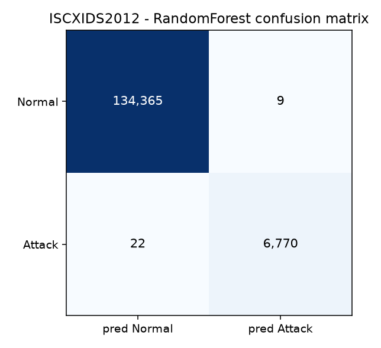
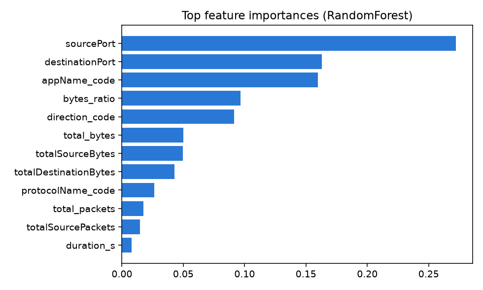

# DE0849 Telecommunications Software - Project 2
## Telecommunication Security, DevSecOps, and Traffic Intelligence

**Author:** Vasif Yusifli, 261AEM001
**Course:** DE0849 Telecommunications Software - Riga Technical University (2026/27)
**Builds on:** [Project 1](https://github.com/Vasif11/DE0849-Project1) (5G Standalone: UERANSIM + Open5GS).
**Workflow:** Reuse → Secure → Model → Test → Detect → Automate → Analyze → Defend.

Project 2 adds security to the reproducible software-based 5G telecommunications environment from
Project 1, in two levels:

* **Scenario A - BASIC**: a secure application over the real 5G user plane - Django behind an Nginx
  TLS gateway with authentication, authorization, CSRF, secure cookies, HSTS and security headers,
  reached through `UE → gNB → N3/GTP-U → UPF → N6 → Nginx → Django`.
* **Scenario B - ADVANCED**: a Jenkins-orchestrated Security CI/CD pipeline around an isolated,
  deliberately vulnerable target (OWASP Juice Shop) - Preflight, ZAP, Selenium, controlled SQLi,
  fresh PCAP, offline Suricata IDS, Trivy, Syft SBOM, evidence correlation and a configurable
  Security Gate - plus an independent **ISCXIDS2012** IDS evaluation and **LLM-assisted
  cross-validation**.

> **Scope / RAM note.** The lab host is Windows 11 + WSL2 with a 4 GB WSL budget, so the 5G stack
> (Scenario A) and the security-testing stack (Scenario B) are run **in turn**, not simultaneously.
> Scenario B is a security-engineering extension and is deliberately **not** on the 5G user plane,
> consistent with the guidebook. Deviations are documented where they occur.

---

## Contents
1. [Key results](#1-key-results)
2. [Architecture and addressing](#2-architecture-and-addressing)
3. [Reproduction](#3-reproduction)
4. [Scenario A - secure application baseline](#4-scenario-a---secure-application-baseline)
5. [Scenario B - security CI/CD pipeline](#5-scenario-b---security-cicd-pipeline)
6. [ISCXIDS2012 IDS evaluation](#6-iscxids2012-ids-evaluation)
7. [LLM-assisted cross-validation](#7-llm-assisted-cross-validation)
8. [Security Gate: REPORT_ONLY vs ENFORCE](#8-security-gate-report_only-vs-enforce)
9. [Repository layout, limitations, reproducibility](#9-repository-layout-limitations-reproducibility)

---

## 1. Key results

| # | Result | Evidence |
|---|---|---|
| 1 | Secure app works over the **real 5G path** with genuine CA validation: HTTP→301→HTTPS, TLS 1.2/1.3, auth, CSRF (200 valid / 403 missing), HSTS, security headers, Secure/HttpOnly cookies. | [`results/scenario-a/`](results/scenario-a) |
| 2 | Scenario B pipeline runs all stages in the mandatory order and the Security Gate is **PASS** (REPORT_ONLY). | [`results/scenario-b-pipeline-status.txt`](results/scenario-b-pipeline-status.txt) |
| 3 | **Positive controls both detected:** ZAP **alert 40018** (SQL Injection) = 1 on `/rest/products/search` param `q`; Suricata **SID 1000001** = 1 on the controlled `q=%27%28` request. | `security/reports/zap/...`, `security/ids/scenario-b/ci/eve.json` |
| 4 | Fresh PCAP captured **before** the SQLi activity; contains the controlled request; offline Suricata analysis only. | `security/traffic/scenario-b/ci/juice-shop-ci-sqli.pcapng` |
| 5 | **Trivy**: 12 CRITICAL + 54 HIGH (+89 MEDIUM, 24 LOW); **Syft SBOM**: 2677 components (CycloneDX). | `security/scans/trivy-ci/`, `security/sbom-ci/` |
| 6 | **Traffic intelligence** (IsolationForest) flags the controlled SQLi as anomalous (supplementary). | `security/traffic-intelligence/` |
| 7 | **Correlation = CORRELATED** across app-security + network layers for the same run (common-run association, not a packet-level match). | `security/correlation/scenario-b/` |
| 8 | **Gate difference demonstrated:** same evidence → REPORT_ONLY **PASS**, ENFORCE **FAIL** (Trivy HIGH/CRITICAL blocking). | [`results/security-gate-modes.txt`](results/security-gate-modes.txt) |
| 9 | **ISCXIDS2012** (3 attack scenarios, 470k flows): precision **0.999**, recall **0.997**, F1 **0.998**, FPR **0.0001**; per-scenario detection 98.4–100 %. | [`ids-dataset/results/`](ids-dataset/results) |
| 10 | **LLM cross-validation** (Claude Opus 4.8): 2 tasks, each verified against raw artifacts; no finding rests on the LLM alone. | [`security/llm-cross-validation/`](security/llm-cross-validation) |

---

## 2. Architecture and addressing

### 2.1 Scenario A application path (on the 5G user plane)

```
UE (10.45.0.x, uesimtun0) -> gNB -> N3/GTP-U -> UPF (10.20.6.14 on N6)
   -> N6 dn-net (10.20.6.0/24) -> Nginx TLS gateway 10.20.6.20 (HTTPS)
   -> app-net (10.20.8.0/24) -> Django 10.20.8.20:8000
```

| Component | Image | Networks / address | Role |
|---|---|---|---|
| UE (custom) | `telecom-lab-ueransim:3.3.0-p2` | ran-net 10.20.1.20; `uesimtun0` 10.45.0.x | keeps the route `10.20.6.0/24 → uesimtun0` |
| Nginx gateway | `telecom-lab-nginx:p2` | dn-net **10.20.6.20**, app-net 10.20.8.10 | TLS termination, HTTP→HTTPS, reverse proxy, UE-pool route |
| Django app | `telecom-lab-django:0.1` | **app-net only** 10.20.8.20:8000 | web app, auth, CSRF, security baseline; SQLite on `django-data` |

Django is on `app-net` only - never directly on N6 - so the Nginx gateway is the application-security
boundary. The 5G foundation (Open5GS core, gNB, UPF, MongoDB) is reused unchanged from Project 1.

### 2.2 Scenario B security-testing environment (isolated `security-net` 10.20.10.0/24)

```
project source -> Jenkins orchestrator -> { ZAP, Selenium, capture, Suricata, Trivy, Syft } -> correlation -> Security Gate
Juice Shop 10.20.10.20:3000   Selenium Grid 10.20.10.30:4444
```

Juice Shop is a controlled positive-control target, isolated from the secure Scenario A app and
**not** on the 5G user plane. ZAP, Suricata, Trivy, Syft, capture and correlation are launched on
demand as Docker jobs. Version pins: [`jenkins/RELEASE-MANIFEST.md`](jenkins/RELEASE-MANIFEST.md).

---

## 3. Reproduction

```bash
# Scenario A (reuses the 5G foundation)
sudo pki/gen-pki.sh                                  # local CA + server cert (CA key stays on host)
cp deploy/.env.example deploy/.env                   # set a random DJANGO_SECRET_KEY
sudo docker compose -f deploy/docker-compose.5g.yml  up -d --build
sudo docker compose -f deploy/docker-compose.app.yml up -d --build
sudo ./scripts/02_verify_scenario_a.sh               # acceptance test -> results/scenario-a/

# Scenario B (stop the 5G/app stack first to free RAM)
sudo docker compose -f deploy/docker-compose.secops.yml up -d   # Juice Shop + Selenium
sudo GATE_MODE=REPORT_ONLY ./scripts/run_pipeline.sh            # full pipeline -> security/, results/
sudo GATE_MODE=ENFORCE     ./scripts/stages/security_gate.sh    # gate difference

# ISCXIDS2012 evaluation (offline, no containers)
python3 ids-dataset/parse_iscx.py /tmp/iscx_flows.csv \
   <SatJun12>:SatJun12:Infiltration <SunJun13>:SunJun13:HTTP_DoS <ThuJun17-3>:ThuJun17:BruteForce_SSH
ISCX_CSV=/tmp/iscx_flows.csv python3 ids-dataset/evaluate_iscx.py
```

Tool versions are pinned in [`jenkins/RELEASE-MANIFEST.md`](jenkins/RELEASE-MANIFEST.md). The
Jenkins CI definition is [`jenkins/Jenkinsfile`](jenkins/Jenkinsfile) (see the deviation note in §5).
`deploy/.env`, `pki/ca.key` and `secrets/` are git-ignored.

---

## 4. Scenario A - secure application baseline

A local PKI (`pki/gen-pki.sh`) issues `Telecom Lab Root CA → server cert (IP:10.20.6.20,
DNS:telecom-lab.local, DNS:localhost)`; the CA private key stays on the host and is never mounted.
All checks are made **from the UE container over the real 5G path** with genuine CA validation
(`curl --cacert`, never `-k`). Evidence: [`results/scenario-a/`](results/scenario-a).

| Phase | Requirement | Result |
|---|---|---|
| 1A | UE reaches N6 via PDU tunnel | route `10.20.6.0/24 dev uesimtun0`; `ip route get 10.20.6.20 → uesimtun0`; ping 1.25 ms |
| 1B | Django internal app | container `healthy`; `/health/` → `{"service":"project2-django","status":"ok",...}`; SQLite `/app/data/db.sqlite3`; app-net only |
| 1C | TLS gateway | cert SAN `IP:10.20.6.20, DNS:telecom-lab.local, DNS:localhost`; **TLS 1.2 & 1.3** OK, TLS 1.0 rejected; `HTTP:80 → 301 → HTTPS:443` |
| 1D | Public endpoints | `GET /`, `/health/`, `/api/status/`, `/search/` → 200 (HTTPS) |
| 1D | AuthN/AuthZ | unauth `/profile/`,`/feedback/` → **302** to login; after login `/profile/` → **200**, `securityadmin, Authenticated: True` |
| 1D | CSRF | valid-token `POST /feedback/` → **200**; missing token → **403** (control kept enabled) |
| 1D | Secure cookies | `sessionid`: `Secure; HttpOnly; SameSite=Lax`; `csrftoken`: `Secure; SameSite=Lax` |
| 1D | Security headers | `Strict-Transport-Security: max-age=3600`, `X-Frame-Options: DENY`, `X-Content-Type-Options: nosniff`, `Referrer-Policy: same-origin` |
| 1E | End-to-end over 5G | `curl --cacert` from UE (local 10.45.0.2) → Nginx 10.20.6.20 → Django → HTTP 200 |

Django recognises the client request as HTTPS behind the proxy via
`SECURE_PROXY_SSL_HEADER=("HTTP_X_FORWARDED_PROTO","https")`, so HSTS and secure cookies are emitted
although TLS terminates at Nginx (`SECURE_HSTS_INCLUDE_SUBDOMAINS=False`, `SECURE_HSTS_PRELOAD=False`).

---

## 5. Scenario B - security CI/CD pipeline

`scripts/run_pipeline.sh` is the reproducible, Jenkins-equivalent orchestrator; it runs the
guidebook's mandatory stage order and produces the evidence below. Final run
`RUN_ID=20261024-113816`, Gate **PASS** (REPORT_ONLY).

| # | Stage | Result | Evidence |
|---|---|---|---|
| 2A | Preflight | **PASS** (Juice Shop 200, Grid ready, images/network/rule/plan present) | `ci-artifacts/<run>/preflight.json` |
| 2B-1 | ZAP Baseline | completed, exit 2 (warnings; not a failure by itself) | `security/reports/zap/scenario-b-ci/` (HTML/MD/JSON) |
| 2B-2 | Selenium runtime/auth | **login_success = true**, token in localStorage, screenshot | `security/selenium/evidence/` |
| 2B-3 | Start fresh capture | capture armed **before** the SQLi activity | - |
| 2B-4 | Controlled SQLi positive control | `GET /rest/products/search?q=%27%28` → HTTP 500 | `ci-artifacts/<run>/controlled-sqli-response.json` |
| 2B-5 | Targeted ZAP SQLi | **alert 40018 = 1** on param `q` (attack `apple'`) | `security/reports/zap/scenario-b-ci-targeted/` |
| 2C | Stop capture + validate PCAP | 105 packets, SQLi request present | `security/traffic/scenario-b/ci/juice-shop-ci-sqli.pcapng` |
| 2C | Suricata offline analysis | **SID 1000001 = 1** | `security/ids/scenario-b/ci/{eve.json,fast.log,stats.log,suricata.log}` |
| 2C-Adv | Traffic intelligence | IsolationForest; controlled SQLi flagged anomalous | `security/traffic-intelligence/` |
| 2D | Trivy | **12 CRITICAL, 54 HIGH** | `security/scans/trivy-ci/juice-shop-v20.2.0.json` |
| 2D | Syft SBOM | **2677 components** (CycloneDX) | `security/sbom-ci/juice-shop-v20.2.0.cdx.json` |
| 2E | Correlation | **CORRELATED** | `security/correlation/scenario-b/security-event-correlation.{json,md}` |
| - | Security Gate | **PASS** (REPORT_ONLY) / FAIL (ENFORCE) | [§8](#8-security-gate-report_only-vs-enforce) |

**Positive controls are distinct.** ZAP alert 40018 (application-security) and Suricata SID 1000001
(network detection) are different identifiers, tools and layers. The ZAP targeted test injects into
`/rest/products/search` param `q` (e.g. `apple'`), while the controlled network positive control is
the deterministic `GET /rest/products/search?q=%27%28`. They are the same endpoint and run but
**different HTTP transactions** - see the correlation caveat and the LLM cross-validation (§7).
A passing pipeline does **not** mean Juice Shop is secure - it means the security-validation process
executed correctly and produced the expected evidence.

**Documented deviations.**
- **ZAP targeted scan** uses the **ZAP API** (`security/zap/targeted_sqli_scan.py`, a ZAP daemon)
  rather than the Automation Framework `plan.yaml`, because Juice Shop is an Angular SPA whose REST
  endpoints the traditional spider does not map; the persistent `plan.yaml` is retained as the
  intended-test definition. This satisfies the same objective (deterministic detection of alert
  40018) with clearly justified evidence.
- **Suricata** runs with the image's default `suricata.yaml` + our local rules via `-S` (`-k none`
  for offline pcap checksums), which parses HTTP correctly; `security/suricata/suricata.yaml` is kept
  for reference.
- **Jenkins** is provided as a complete CI definition (`jenkins/Jenkinsfile`, Dockerfile, plugins,
  release manifest) but the pipeline is executed by the identical-stage orchestrator
  `scripts/run_pipeline.sh` on the 4 GB host, where Jenkins + Juice Shop + Selenium + ephemeral jobs
  do not fit in memory together.

---

## 6. ISCXIDS2012 IDS evaluation

Independent evaluation on the ISCXIDS2012 labelled flow dataset (`ids-dataset/`). Full report:
[`ids-dataset/results/iscx-evaluation.md`](ids-dataset/results/iscx-evaluation.md).

**Selected subset** (normal traffic + **three** distinct intrusion scenarios):

| Scenario (file) | Flows | Attack flows | Attack category |
|---|---:|---:|---|
| SatJun12 (`TestbedSatJun12Flows.xml`) | 133,193 | 2,086 | Infiltration from inside |
| SunJun13 (`TestbedSunJun13Flows.xml`) | 275,528 | 20,358 | HTTP DoS |
| ThuJun17 (`TestbedThuJun17-3Flows.xml`) | 61,832 | 197 | Brute-force SSH |
| **Total** | **470,553** | **22,641** | 4.81 % attack (class imbalance) |

**Method:** streaming XML parse → per-flow features (bytes, packets, ports, duration, protocol,
direction, appName) → **Random Forest** (supervised, 70/30 stratified, `class_weight=balanced`).

**Confusion matrix (test set):** TN 134,365 · FP 9 · FN 22 · TP 6,770.

| Metric | Value |
|---|---:|
| Precision | **0.9987** |
| Recall / detection rate | **0.9968** |
| F1-score | **0.9977** |
| False-positive rate | **0.0001** |
| Accuracy (not relied on alone) | 0.9998 |

**Per-scenario detection:** Infiltration **100 %** (635/635), HTTP DoS **99.66 %** (6075/6096),
Brute-force SSH **98.36 %** (60/61).




The report discusses **class imbalance** (accuracy is misleading at 4.8 % attack; precision/recall/FPR
and per-scenario detection are used instead), **dataset limitations** (2010 testbed, coarse flow
durations, under-represented SSH attack), **method limitations** (supervised, learns these labels,
offline not inline), and the gap between **benchmark performance and real-world 5G telecom security**.

---

## 7. LLM-assisted cross-validation

Full document: [`security/llm-cross-validation/llm-cross-validation.md`](security/llm-cross-validation/llm-cross-validation.md).
Model **Claude Opus 4.8** (Anthropic), 2026-10-24. LLM output is treated as a hypothesis and
**verified against the raw machine-generated artifacts**; no finding rests on the LLM alone.

| Task | LLM conclusion | Verified against artifacts | Disagreement |
|---|---|---|---|
| **1 - SBOM vs Trivy** (required) | 12 CRIT / 54 HIGH in a small package set; SBOM gives traceability, not a verdict | counts confirmed; **25/25** HIGH/CRITICAL vulnerable packages present in the SBOM (0 missing) | none (nuance confirmed: 2677 components ≠ 2677 risks) |
| **2 - Correlation claim** | `CORRELATED` = common-run association, **not** a packet-level match | Suricata uri `q=%27%28` vs ZAP `q=apple'` - same endpoint/run, **different transactions** | none (guards against the wrong "same transaction" claim) |

---

## 8. Security Gate: REPORT_ONLY vs ENFORCE

Same evidence, both modes ([`results/security-gate-modes.txt`](results/security-gate-modes.txt)):

```
===== GATE_MODE=REPORT_ONLY =====
TOOL RESULTS:  ZAP_40018=1  Suricata_1000001=1  Correlation=CORRELATED  Trivy_HIGH=54  Trivy_CRITICAL=12
FINDING: Trivy HIGH/CRITICAL=66 -> informational under REPORT_ONLY
GATE_DECISION (REPORT_ONLY): PASS

===== GATE_MODE=ENFORCE =====
FINDING: Trivy HIGH/CRITICAL=66 -> ENFORCE threshold violated (blocking)
GATE_DECISION (ENFORCE): FAIL  reasons: trivy-high/critical(ENFORCE);
```

- **Informational (both modes):** the ZAP baseline findings and the Trivy severity counts.
- **Required to pass (both modes):** the positive controls (ZAP 40018, Suricata SID 1000001) and the
  correlation status (`CORRELATED`). A failure in any of these fails the build regardless of mode.
- **Blocking only under ENFORCE:** the Trivy HIGH/CRITICAL threshold (66 findings) - informational in
  REPORT_ONLY, build-failing in ENFORCE.

Tool execution result → security finding → gate decision are reported **separately**: Trivy runs
successfully *and* reports 66 HIGH/CRITICAL *and* the gate only blocks on them under ENFORCE.

---

## 9. Repository layout, limitations, reproducibility

```
DE0849-Project2/
├── README.md
├── deploy/            docker-compose.{5g,app,secops}.yml; django/, nginx/, ueransim-p2/, open5gs/, mongodb/
├── pki/               gen-pki.sh, ca.crt   (ca.key git-ignored)
├── secrets/tls/       server cert/key      (git-ignored)
├── scripts/           lib.sh, 02_verify_scenario_a.sh, ue_app_tests.sh, run_pipeline.sh, stages/
├── jenkins/           Jenkinsfile, Dockerfile, plugins.txt, RELEASE-MANIFEST.md
├── security/          zap/, selenium/, suricata/, ids/rules/, traffic-intelligence/, correlation/,
│                      llm-cross-validation/, and the generated evidence (reports, pcap, eve.json,
│                      trivy, sbom, correlation)
├── ids-dataset/       parse_iscx.py, evaluate_iscx.py, results/, figures/
└── results/           scenario-a/, scenario-b-pipeline-status.txt, security-gate-modes.txt
```

**Limitations.**
- **RAM-staged execution.** Scenario A (5G) and Scenario B (security) run in turn on the 4 GB host.
- **Positive controls, not a pen-test.** ZAP 40018 and Suricata SID 1000001 validate that the
  detection mechanisms work against a known-vulnerable target; they do not prove full coverage, and a
  passing pipeline does not mean Juice Shop is secure.
- **Correlation** is a same-run, same-endpoint association across layers, not a packet-level identity
  (the ZAP and captured requests are different transactions - verified in §7).
- **ISCX** is a 2010 benchmark; high scores there do not transfer to live 5G traffic (encryption,
  GTP-U encapsulation, novel attacks). The value is the methodology, not the absolute numbers.
- **Traffic intelligence** results are supplementary, not a replacement for the deterministic
  ZAP/Suricata validation.
- **LLM** assists cross-validation only; every LLM claim is verified against the raw artifacts.

**Secrets never committed:** `deploy/.env`, `pki/ca.key`, `secrets/tls/` are git-ignored; the lab CA
private key stays on the host and is never mounted into any container.
